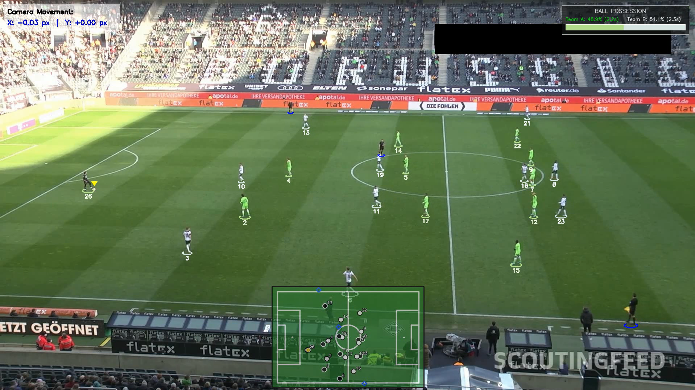

# Football Analyst Project

Dự án phân tích video bóng đá bằng computer vision: phát hiện và tracking cầu thủ, trọng tài, bóng; gán đội theo màu áo; chiếu vị trí lên sơ đồ sân; tính vận tốc, quãng đường và thống kê kiểm soát bóng.

## Mục lục

- [Football Analyst Project](#football-analyst-project)
  - [Mục lục](#mục-lục)
  - [Project Title](#project-title)
  - [Demo](#demo)
  - [Introduction](#introduction)
  - [Features](#features)
  - [System Architecture](#system-architecture)
    - [Pipeline hiện tại (`main.py`)](#pipeline-hiện-tại-mainpy)
    - [Hướng tiếp cận thử nghiệm trong `experiment/`](#hướng-tiếp-cận-thử-nghiệm-trong-experiment)
  - [Technologies Used](#technologies-used)
  - [Model \& Training](#model--training)
  - [Installation](#installation)
    - [Yêu cầu](#yêu-cầu)
    - [Cài đặt môi trường](#cài-đặt-môi-trường)
  - [Usage](#usage)
    - [1. Chuẩn bị đường dẫn](#1-chuẩn-bị-đường-dẫn)
    - [2. Chạy](#2-chạy)
    - [3. Stub/cache](#3-stubcache)
    - [4. Tinh chỉnh minimap](#4-tinh-chỉnh-minimap)
  - [Results \& Evaluation](#results--evaluation)
  - [11. Kết quả và đánh giá (Results \& Evaluation)](#11-kết-quả-và-đánh-giá-results--evaluation)
    - [11.1. Player Detection](#111-player-detection)
    - [11.2. Ball Detection](#112-ball-detection)
    - [11.3. Pitch Keypoint Detection](#113-pitch-keypoint-detection)
    - [11.4. Limitations](#114-limitations)
  - [Project Structure](#project-structure)
  - [References](#references)

## Project Title

**Football Analyst AI — Phân tích và trực quan hóa trận đấu bóng đá**


## Demo

Video kết quả mẫu được lưu tại `Outputs/Match_Video_R.mp4`. Ảnh dưới đây là khung hình trích từ kết quả:


## Introduction

Project xử lý video trận đấu quay từ camera truyền hình. Hệ thống kết hợp phát hiện đối tượng, theo dõi ID qua các frame và nhận diện landmark trên mặt sân. Các landmark được ghép với tọa độ sân chuẩn để ước lượng homography cho từng frame; từ đó vị trí cầu thủ, trọng tài và bóng có thể được quy đổi lên minimap. Tọa độ sân theo mét cũng là đầu vào cho phép tính vận tốc và quãng đường.

Camera lia, zoom, che khuất, góc nhìn phối cảnh và chất lượng keypoint đều ảnh hưởng đến độ chính xác. Vì vậy kết quả minimap và các chỉ số vật lý là ước lượng phụ thuộc chất lượng video/model, không phải số liệu đo đạc chính xác tuyệt đối.

## Features

- Phát hiện và tracking cầu thủ, trọng tài và bóng; bóng được xử lý bởi detector riêng và có bước nội suy khi bị mất dấu.
- Gán cầu thủ vào hai đội dựa trên đặc trưng màu áo.
- Phát hiện các keypoint/landmark sân bằng model keypoint.
- Ước lượng homography từ landmark model sang tọa độ sân mục tiêu, dùng ghép ID landmark và RANSAC để loại correspondence ngoại lai.
- Tạo minimap sân bóng, chiếu vị trí các đối tượng lên map và ghép minimap bán trong suốt vào video.
- Tính vận tốc (km/h) và quãng đường tích lũy (m) của cầu thủ từ tọa độ sân đã chiếu (`position_pitch`).
- Ước lượng thời lượng kiểm soát bóng theo đội.
- Lưu kết quả inference trung gian dạng pickle stub để chạy lại nhanh khi chỉ chỉnh phần hiển thị hoặc phân tích.

## System Architecture

### Pipeline hiện tại (`main.py`)

```text
Video đầu vào
   │
   ├─ Detector/tracker ───────────────► tracks cầu thủ, trọng tài, bóng
   ├─ Keypoint model ─────────────────► landmark sân theo từng frame
   ├─ TeamAssigner ───────────────────► nhãn đội / màu áo
   ├─ Ball interpolation ─────────────► quỹ đạo bóng liên tục hơn
   ├─ CameraMovement (optical flow) ──► ước lượng dịch chuyển camera
   ├─ MiniMap / homography RANSAC ────► position_pitch và position_minimap
   ├─ Measurement ────────────────────► vận tốc và quãng đường
   ├─ Ball possession ────────────────► thống kê kiểm soát bóng
   └─ Annotation ─────────────────────► video đầu ra
```

Pipeline được gọi từ `main.py`; phần chi tiết nằm trong các package dưới `src/`.

### Hướng tiếp cận thử nghiệm trong `experiment/`

`experiment/View_Transform` và `experiment/Camera_movement` là **phiên bản tiếp cận đầu tiên**, tách biệt với cách chiếu landmark theo minimap đang dùng trong `src/Minimap`:

1. Dùng Lucas–Kanade optical flow để theo dõi các feature giữa hai frame liên tiếp.
2. Từ flow, ước lượng độ dịch chuyển camera; cộng dồn chuyển động và trừ phần này khỏi vị trí đối tượng để bù camera movement.
3. Chọn thủ công **bốn điểm cố định trong video** (tọa độ pixel ở một góc nhìn cụ thể) và ghép chúng với bốn đỉnh vùng sân mục tiêu.
4. Tính homography bằng `cv2.getPerspectiveTransform` để đổi tọa độ pixel sang mặt phẳng sân.

Cách thử nghiệm này phụ thuộc vào bốn điểm đã chọn và góc camera. Khi camera đổi góc đáng kể, các điểm cố định không còn đại diện đúng cho frame mới; vì vậy không nên xem đây là homography thích nghi cho mọi frame.

## Technologies Used

- Python
- OpenCV: đọc/ghi video, xử lý ảnh, optical flow và phép biến đổi phối cảnh
- Ultralytics YOLO: inference các model detection/keypoint
- PyTorch / Torchvision: runtime cho model
- NumPy, Pandas: xử lý tọa độ và dữ liệu tracking
- scikit-learn: clustering màu áo
- Supervision: hỗ trợ xử lý/tracking đối tượng (nếu được gọi bởi cấu hình hiện tại)

Danh sách package nằm trong `requirements.txt`. Các phiên bản trong file là mức tối thiểu; môi trường PyTorch/CUDA cần chọn tương thích với máy.

## Model & Training

Các trọng số model được đặt trong `src/Models/`, gồm các file cho phát hiện bóng/cầu thủ và keypoint sân, ví dụ `balltracker.pt` và `downloaded_pitch.pt`. `Tracker` chịu trách nhiệm khởi tạo detector và ball model; model keypoint cung cấp landmark phục vụ homography.

Thư mục hiện tại chứa trọng số nhưng không kèm đầy đủ dataset, cấu hình huấn luyện và script training có thể tái lập. Do đó README này không khẳng định nguồn dataset, số epoch hay metric đánh giá model. Muốn huấn luyện lại cần chuẩn bị dataset và cấu hình tương ứng với model, sau đó cập nhật đường dẫn trọng số trong mã nguồn.

**Lưu ý correspondence landmark:** model ID và ID điểm trên sân mục tiêu phải khớp chính xác. Bản đồ ID hiện được khai báo trong `MiniMap`; các ID không có mapping sẽ không được dùng để fit homography. Chất lượng homography còn phụ thuộc số lượng, phân bố không gian, confidence và độ chính xác của keypoint trong frame.

## Installation

### Yêu cầu

- Python 3.10–3.12 (nên dùng phiên bản tương thích với bộ PyTorch đã cài)
- Windows, Linux hoặc macOS
- GPU NVIDIA/CUDA là tùy chọn; CPU có thể chạy chậm hơn
- Video đầu vào và các file trọng số trong `src/Models/`

### Cài đặt môi trường

Từ thư mục gốc dự án:

```powershell
python -m venv .venv
.\.venv\Scripts\Activate.ps1
python -m pip install --upgrade pip
```

Cài PyTorch/Torchvision phù hợp với CPU hoặc phiên bản CUDA trên máy theo hướng dẫn chính thức của PyTorch, sau đó cài các dependency còn lại:

```powershell
pip install -r requirements.txt
```

Trên Linux/macOS, kích hoạt môi trường bằng `source .venv/bin/activate`.

## Usage

### 1. Chuẩn bị đường dẫn

Mở `main.py` và kiểm tra các biến `input_video_path`, `output_video_path`, `stub_path`, `camera_stub_path`. Các đường dẫn hiện tại trong file được viết theo cấu trúc thư mục cha `Personal_Project/Football_Analyst_Project/...`; nếu chạy trực tiếp từ thư mục dự án hoặc đặt project ở nơi khác, hãy sửa thành đường dẫn phù hợp, ví dụ:

```python
input_video_path = "Inputs/videomy.mp4"
output_video_path = "Outputs/Match_Video_R.mp4"
stub_path = "Stubs/stub_minimap_ball_v3.pkl"
camera_stub_path = "Stubs/camera_movement_stub.pkl"
```

Đảm bảo các thư mục `Outputs/` và `Stubs/` tồn tại, video có thể mở được và đường dẫn trọng số trong `src/Tracker/Tracker.py` trỏ tới file model có thật.

### 2. Chạy

```powershell
python main.py
```

Video đã annotate được ghi theo `output_video_path`.

### 3. Stub/cache

Trong `main.py`, `use_stub=True` sẽ đọc kết quả đã cache nếu stub tồn tại. Khi đổi video, model, thông số inference hoặc logic tracking, hãy dùng đường dẫn stub mới hoặc đặt `use_stub=False` để tạo lại dữ liệu. Stub detection và stub camera movement là hai cache riêng; cache cũ có thể không còn tương thích với thay đổi mới.

### 4. Tinh chỉnh minimap

Kiểm tra `keypoint_to_target` và `target_points` trong `src/Minimap/minimap.py` để bảo đảm các model keypoint được ghép đúng với landmark sân. Không nên thêm mapping chỉ dựa trên thứ tự ID nếu chưa xác minh bằng ảnh có nhãn. Khi không đủ correspondence/inlier đáng tin cậy, phép chiếu có thể giữ homography gần nhất trong một số frame hoặc thiếu vị trí mới; đây là giới hạn cần cân nhắc khi đánh giá output.

## Results & Evaluation

Output hiện trực quan hóa tracking, màu đội, minimap, vị trí bóng và các chỉ số vận tốc/quãng đường, cùng thông tin kiểm soát bóng khi bật. `Outputs/Match_Video_R.mp4` là video kết quả mẫu được lưu trong project.

## 11. Kết quả và đánh giá (Results & Evaluation)

Project sử dụng 3 mô hình Computer Vision chính để thực hiện các nhiệm vụ phân tích trận đấu bóng đá. Mỗi mô hình được đánh giá riêng biệt dựa trên các chỉ số phù hợp với nhiệm vụ của nó.

### 11.1. Player Detection

Đánh giá khả năng phát hiện cầu thủ trên các hình ảnh thuộc tập dữ liệu kiểm thử (Test Set).

**Evaluation Metrics:**

| Metric | Result |
|---|---|
| Precision | 0.9840338512267189 |
| Recall | 0.972972972972973|
| mAP@50 | 0.9729623458812067|
| mAP@50-95 | 0.8206878211900737 |


### 11.2. Ball Detection

Đánh giá khả năng phát hiện quả bóng trong các tình huống thi đấu khác nhau, đặc biệt khi bóng có kích thước nhỏ hoặc xuất hiện ở khoảng cách xa.

**Evaluation Metrics:**

| Metric | Result |
|---|---|
| Precision | 0.9770897163080994 |
| Recall | 0.5454545454545454 |
| mAP@50 | 0.728 |
| mAP@50-95 | 0.35719 |

**Visualization Results:**


### 11.3. Pitch Keypoint Detection

Đánh giá khả năng xác định chính xác các điểm đặc trưng trên sân bóng. Các keypoint này được sử dụng để tính toán Homography, ánh xạ tọa độ từ hình ảnh thực tế sang mặt phẳng sân bóng và xây dựng MiniMap.

**Evaluation Metrics:**

| Metric | Result |
|---|---|
| Pose Precision |  0.9894305341861706 |
| Pose Recall | 1.0 |
| Pose mAP50| 0.995|
Pose mAP50-95  0.7205

**Visualization Results:**


### 11.4. Limitations

Phân tích những hạn chế của từng mô hình thông qua kết quả thực nghiệm:

- **Player Detection:** Khó phát hiện cầu thủ khi bị che khuất hoặc xuất hiện ở khoảng cách xa.
- **Ball Detection:** Có thể bỏ sót bóng khi bóng di chuyển nhanh, kích thước nhỏ hoặc bị che khuất.
- **Pitch Keypoint Detection:** Độ chính xác của keypoint có thể bị ảnh hưởng bởi góc quay camera, vật thể che khuất và chất lượng hình ảnh.
## Project Structure

```text
Football_Analyst_Project/
├── experiment/
│   ├── Camera_movement/       # Optical flow và ước lượng camera movement (hướng thử nghiệm đầu tiên)
│   └── View_Transform/        # Homography từ 4 cặp điểm cố định (hướng thử nghiệm đầu tiên)
├── Inputs/                    # Video đầu vào
├── Outputs/                   # Video/ảnh kết quả
├── Stubs/                     # Cache pickle của tracking và camera movement
├── src/
│   ├── Color_Analyst/         # Notebook phân tích màu
│   ├── Constant/              # Hằng số dùng trong project
│   ├── Distance_And_Velocity/ # Tính và vẽ quãng đường, vận tốc
│   ├── Minimap/               # Sân mục tiêu, mapping keypoint, homography, minimap
│   ├── Models/                # Trọng số .pt
│   ├── Team_Assigner/         # Gán đội theo màu áo
│   ├── Tracker/               # Detection, tracking và annotation video
│   └── Utils/                 # Hàm tiện ích tọa độ và video
├── main.py                    # Điều phối pipeline
├── requirements.txt           # Python dependencies
└── README.md
```

## References

- [Ultralytics documentation](https://docs.ultralytics.com/)
- [OpenCV documentation](https://docs.opencv.org/)
- [OpenCV: Optical Flow](https://docs.opencv.org/4.x/d4/dee/tutorial_optical_flow.html)
- [PyTorch installation guide](https://pytorch.org/get-started/locally/)
- [NumPy documentation](https://numpy.org/doc/)
- [Pandas documentation](https://pandas.pydata.org/docs/)
- [scikit-learn documentation](https://scikit-learn.org/stable/)
